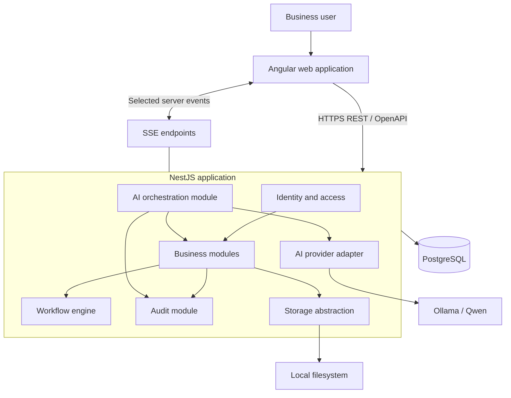

# Flow Pilot — Architecture Proposal

**Status:** Draft for review  
**Version:** 0.1  
**Date:** 2026-11-06  
**Decision state:** Proposed baseline; not approved for implementation

## 1. Purpose and scope

This document consolidates the architecture decisions made during the Flow Pilot architecture rounds. It is a review document, not an implementation instruction.

Flow Pilot is a configurable business-operations workspace for small service and repair businesses that receive customer-owned items, process them, and return them. The initial real-world case study is a small sharpening business that services carpentry and woodworking tools and saws, has some retail activity, and mostly receives and dispatches shipments.

The product must remain configurable for businesses with different intake, workshop, collection, delivery, and return processes. The MVP focuses on one business. The architecture should establish a Workspace boundary so that multi-business SaaS can be added later without building full SaaS infrastructure now.

### 1.1 Architecture goals

- Deliver a maintainable MVP without premature distributed-system complexity.
- Preserve clear business-module boundaries.
- Support configurable, versioned workflows.
- Track Service Orders and their individual items independently.
- Support multiple locations, facilities, shipments, and partial returns.
- Enforce authorization in the backend.
- Keep AI providers replaceable and AI actions controlled.
- Preserve auditability for important business and AI decisions.
- Make local development straightforward and prepare for later deployment.

### 1.2 Non-goals for the MVP

Unless separately approved, the architecture does not require:

- Microservices.
- Full multi-tenant SaaS onboarding, billing, or tenant administration.
- Redis/BullMQ.
- A customer-facing portal.
- Advanced visual drag-and-drop workflow editing.
- Live courier integrations or label generation.
- SMS/WhatsApp integrations.
- Online payment processing.
- Supplier purchasing and automated replenishment.
- Broad autonomous AI execution.

## 2. Consolidated technology decisions

| Area | Proposed choice | Status / notes |
| --- | --- | --- |
| Frontend | Angular | Confirmed |
| Frontend state | NgRx | Confirmed; use deliberately for shared/feature state |
| Backend | NestJS + TypeScript | Confirmed direction |
| Architecture | Modular Monolith | Confirmed |
| Database | PostgreSQL | Confirmed direction |
| ORM | Prisma | Confirmed |
| API | REST + OpenAPI | Confirmed |
| Live updates | HTTP first; SSE selectively when needed | Confirmed |
| Authentication | Application-managed, server-managed sessions with cookies | Confirmed |
| Cookie attributes | HttpOnly, Secure in HTTPS environments, suitable SameSite policy | Proposed security configuration |
| Authorization | Backend-enforced RBAC and resource checks; frontend visibility as UX | Confirmed |
| AI model runtime | Ollama running Qwen initially | Confirmed |
| AI integration | Provider/model adapter | Confirmed |
| AI orchestration | Dedicated NestJS module, extractable later | Confirmed |
| File storage | Local filesystem initially behind a storage abstraction | Confirmed |
| Background jobs | Defer Redis/BullMQ until justified | Confirmed |
| Logging | Structured logs, simple local output initially | Confirmed |
| Configuration | Environment variables with schema validation; secrets excluded from Git | Confirmed |
| Repository | Monorepo | Confirmed |
| Development | Local-first | Confirmed |
| CI | Basic lint, type-check, tests and build checks | Confirmed direction |
| Testing | Testing pyramid | Confirmed |
| Backups | Basic PostgreSQL backup/restore preparation; files backed up separately | Confirmed direction |

Versions of Angular, NestJS, Node.js, Prisma, PostgreSQL and NgRx are intentionally not pinned in this proposal. Select mutually compatible supported versions during repository inspection and foundation setup.

## 3. High-level system architecture



The diagram is logical rather than a deployment topology. The MVP runs as a local application stack. AI orchestration is a NestJS module in the same process, not a separate microservice. Ollama is an external local model runtime.

### 3.1 Request path

1. Angular sends a request to the NestJS API.
2. NestJS authenticates the session.
3. Authorization checks the Workspace membership, role/permissions, and resource scope.
4. The owning module validates business rules.
5. The module performs database work through its own persistence boundary.
6. Important operations create audit records.
7. The API returns a documented response.
8. Angular updates its NgRx state or local UI state.

The frontend may hide unavailable actions, but that is never a security control.

## 4. Repository and monorepo proposal

The repository should contain the web application, API, shared contracts, documentation, and local development support.

```text
flow-pilot/
├── apps/
│   ├── web/                    # Angular
│   └── api/                    # NestJS
├── packages/
│   └── api-contracts/          # Only genuinely shared API contracts
├── prisma/
│   ├── schema.prisma
│   └── migrations/
├── infrastructure/
│   ├── local/
│   └── scripts/
├── docs/
│   ├── adr/
│   └── architecture/
├── .github/
│   └── workflows/
├── AGENTS.md
├── ARCHITECTURE.md
├── PROJECT_BRIEF.md
├── MVP_REQUIREMENTS.md
├── DOMAIN_MODEL.md
├── GLOSSARY.md
├── README.md
└── .env.example
```

This is a target structure, not a claim about the current repository. The final placement of the Prisma schema, shared contracts and scripts should be decided after inspecting the actual repository and selected workspace tooling.

Do not create shared packages merely to share code. In particular, business logic must remain owned by its backend module.

## 5. Backend module boundaries

NestJS modules should align with business capabilities. Each module owns its application/domain logic and persistence operations, and exposes a small public interface to other modules.

| Module | Responsibility |
| --- | --- |
| Identity & Access | Authentication, sessions, users, memberships, roles, permissions |
| Workspaces | Workspace boundary and business-level configuration |
| Customers | Individual/business customers, contacts, addresses, preferences |
| Locations | Locations, facilities, employee-location assignments |
| Service Orders | Service Orders, items, lifecycle, item/order histories |
| Shipments | Incoming/outgoing shipments, packages, tracking, item allocations |
| Inventory | Product/material catalog, balances, reservations, stock movements, transfers |
| Quotes & Payments | Estimates, customer decisions, payment records and statuses |
| Workflows | Definitions, versions, publication, executions and transitions |
| AI | Provider adapters, orchestration, tool registry, AI proposals |
| Notifications | Internal and customer notifications and delivery records |
| Reporting | Operational summaries and reports |
| Audit | Structured record of security, business and AI events |

### 5.1 Dependency rules

- Controllers handle transport concerns; they do not own business rules.
- A module must not directly manipulate another module's tables or repositories.
- Cross-module interactions use explicit application interfaces or commands.
- Modules should avoid circular dependencies.
- Shared code is limited to genuinely cross-cutting primitives and API contracts.
- PostgreSQL may be shared by all modules; separate databases are not required.
- Transactions that span multiple business concepts must be explicit and carefully scoped.

A modular monolith is one deployable backend with logical boundaries, not a collection of independently deployed services.

## 6. Frontend architecture

Angular is organised by feature and shared application concerns.

```text
apps/web/src/app/
├── core/
│   ├── auth/
│   ├── guards/
│   ├── interceptors/
│   └── api/
├── shared/
├── layout/
└── features/
    ├── dashboard/
    ├── customers/
    ├── service-orders/
    ├── shipments/
    ├── inventory/
    ├── locations/
    ├── quotes/
    ├── workflows/
    ├── employees/
    ├── reporting/
    └── ai-assistant/
```

### 6.1 State management

NgRx is selected. Use it for shared application state and feature state with meaningful lifecycle or coordination needs. Keep ephemeral component state local. Do not automatically put every form field, modal state, or server response into a global store.

The exact NgRx packages and conventions remain open until the Angular version and application setup are selected.

### 6.2 Workflow interfaces

The MVP uses a guided/simple workflow configurator. A visual drag-and-drop builder is later scope. Both must ultimately use the same backend workflow definition and execution model. The simple interface must not silently discard workflow features it cannot represent.

## 7. Data architecture and integrity

PostgreSQL is selected for relational integrity, transactions and query flexibility. Prisma is the selected ORM.

### 7.1 Workspace boundary

Business-owned records should be associated with a Workspace. The MVP operates with one Workspace, but application queries and authorization must consistently scope access to the active Workspace.

Future multi-tenancy requires more than adding a Workspace ID: it requires tenant-scoped authorization, uniqueness constraints, background-job context, file access controls, audit scoping, and tests proving that cross-Workspace access is rejected.

Database row-level security may be evaluated later, but it is not selected as an MVP requirement in this proposal.

### 7.2 Service Orders and items

- A Service Order is the customer-facing work container.
- A Service Order contains one or more Service Order Items.
- Order-level and item-level statuses are distinct.
- Each item tracks its own service, condition, quantity, assignment, price and processing history as applicable.
- The order's overall state must be derived or transitioned according to explicit business rules; it must not erase item-level progress.
- Intake method is configurable and includes shipment received, customer drop-off and employee collection.

Customer-owned items being serviced must not be confused with the business's own inventory products/materials.

### 7.3 Shipments and partial returns

Shipment is a separate entity linked to a Service Order. The model must support:

- Multiple incoming shipments for one Service Order.
- Multiple outgoing shipments for one Service Order.
- Partial returns across different shipments.
- A shipment containing allocations of quantities from one or more Service Order Items, subject to business rules.
- Tracking and package information without assuming one tracking number per order.

A shipment-item/allocation entity should link a shipment to a Service Order Item and record the quantity allocated. Do not link customer shipment contents to InventoryBalance.

Open design detail: decide whether tracking belongs to a shipment, a package, or both, based on the actual carrier scenarios. Avoid fixing this without validating the business case.

### 7.4 Inventory

The stock movement ledger is the source of truth for physical stock changes. Reservations are represented separately from physical movements.

Conceptually:

```text
on_hand = sum(confirmed physical stock movements)
reserved = sum(active reservations)
available = on_hand - reserved
```

Consumed quantities are represented by outbound/consumption movements, not by subtracting an additional “consumed” number from available stock a second time. The precise movement types and reservation lifecycle need to be defined in the domain model.

For concurrent reservations, perform availability checks and reservation writes transactionally, with appropriate database locking or concurrency controls. Do not rely on a frontend check.

Inventory is location-aware. Transfers should have traceable source and destination effects. A transfer must not create or destroy stock; it changes where stock is held, with explicit in-transit handling only if the business requires it.

Customer-owned items in service are not inventory stock.

### 7.5 Quotes and payments

Quotes/estimates and payments have separate lifecycles. A quote may be accepted or rejected; payment status must not be inferred from quote status. Integrated online payment processing is outside the MVP unless later approved.

### 7.6 Workflow definitions and executions

- WorkflowDefinition is the logical workflow identity.
- WorkflowVersion is an immutable published definition.
- WorkflowExecution references the exact version used at start.
- Workflow execution state and step history are distinct from the workflow definition.
- Publishing a new version does not silently change existing executions.
- Controlled migration of active executions is a future capability requiring explicit rules, validation and audit.

The workflow model must clarify whether workflows apply to Service Orders, Service Order Items, or both. This is an unresolved domain decision and must not be hidden in implementation.

## 8. Authentication, authorization and security

### 8.1 Authentication

Application-managed authentication is selected. For the browser application, the proposed mechanism is server-managed sessions using secure cookies.

Cookie security requirements:

- `HttpOnly` to prevent JavaScript access.
- `Secure` in HTTPS environments.
- A deliberate `SameSite` policy consistent with deployment topology.
- CSRF protection appropriate to the chosen cookie/session design.
- Session rotation and invalidation on login, logout, password change and other relevant security events.
- Passwords stored using a modern password-hashing algorithm through a maintained library; never store plaintext passwords.

Exact session storage, expiration, password reset and account recovery policies remain to be decided.

### 8.2 Authorization

Use Workspace-scoped role-based access control (RBAC), with custom roles and granular permissions.

- Backend authorization is mandatory on every protected operation.
- Check the authenticated user, Workspace membership, permission and resource scope.
- Frontend guards and visibility rules improve usability only.
- Employees may have multiple roles, subject to a clearly defined permission-combination policy.
- AI tools execute under the requesting user's effective permissions.
- Never trust Workspace IDs, user IDs, prices, stock quantities or permission claims supplied by the client without server-side verification.

### 8.3 Sensitive data

Minimise sensitive data collection and avoid logging passwords, session identifiers, tokens, full payment credentials or unnecessary customer data. Define retention and deletion policies before production use.

## 9. AI architecture and governance

AI orchestration is a dedicated NestJS module in the same process for the MVP. It is designed with a provider adapter and clear boundaries so it can be extracted into a separate service later if scale, isolation or deployment needs justify it.

### 9.1 Model integration

- Ollama is the initial local model runtime.
- Qwen is the initial model family.
- Model/runtime calls are isolated behind an adapter.
- Model-specific prompts, response parsing and tool-call compatibility stay inside the AI integration layer.
- Business rules remain in business modules.
- Do not assume a particular Qwen model supports reliable structured tool calling until it has been tested.

### 9.2 Controlled tool execution

The model does not connect directly to PostgreSQL. It can request a registered tool. The backend validates:

1. Tool identity and input schema.
2. Authenticated user and Workspace context.
3. Required permissions and resource access.
4. Business invariants.
5. Whether the operation is read-only or a proposal/action requiring approval.

Tools should call existing module interfaces rather than duplicate business logic.

### 9.3 MVP autonomy

MVP AI capabilities:

- Answer operational questions using permission-filtered data.
- Natural-language search across supported business records.
- Summarise orders and customer histories.
- Identify possible overdue work and stock shortages.
- Suggest workflow improvements.
- Generate workflow proposals for review.

AI-generated workflows require human approval by default before activation. Broader autonomous business actions are outside MVP scope.

### 9.4 AI audit records

Record the user/request context, proposal, structured changes, decision (approved/rejected/edited), decision-maker, timestamps, and resulting workflow version/activation. Do not store hidden chain-of-thought or unnecessary sensitive prompt content.

## 10. File storage

Use a storage interface owned by the backend. The MVP implementation stores files on the local filesystem.

The interface should support upload, retrieval, deletion, metadata and authorization checks. Persist metadata in PostgreSQL, not file binaries. Store files outside public web roots and serve them only after authorization.

Future object storage (for example, S3-compatible storage) should be implementable behind the same interface. Local filesystem storage must not be treated as production-ready shared storage for a multi-instance deployment.

## 11. API, live updates and background work

REST is the initial API style, documented with OpenAPI. Use DTO validation and consistent error response conventions.

Use ordinary HTTP request/response for most interactions. Introduce SSE selectively for server-to-client updates such as order status changes or notifications where live updates materially improve the experience. WebSockets are not required initially.

Do not introduce Redis/BullMQ at the start. Keep long-running or scheduled work identifiable and behind a job abstraction only where useful. Revisit a queue when retries, scheduling, throughput or independent workers become real requirements. Do not pretend that in-process background work is durable across restarts.

## 12. Testing strategy

Adopt a testing pyramid:

- **Unit tests:** domain rules, calculations, state transitions, permission decisions and workflow validation.
- **Integration tests:** NestJS module boundaries, Prisma queries, PostgreSQL constraints and transactions.
- **End-to-end tests:** critical user journeys across API and Angular.

Priority scenarios:

- Workspace isolation and forbidden cross-Workspace access.
- Role/permission enforcement at API level.
- Service Order with multiple items and independent item statuses.
- Multiple incoming shipments and partial outgoing returns.
- Concurrent stock reservation and stock consumption.
- Inventory transfer between locations.
- Workflow version publication and execution immutability.
- AI proposal approval/rejection and audit trail.
- AI tool permission enforcement.

Use a real PostgreSQL test environment for tests that depend on database semantics. Mock external model calls in most automated tests; maintain a smaller integration test suite against the configured Ollama/Qwen runtime.

## 13. Logging, configuration, CI and recovery

### 13.1 Logging

Use structured logs with request/correlation IDs, severity, module and safe contextual fields. Start with local console output. Do not log secrets or sensitive payloads. Centralised observability can be introduced later.

### 13.2 Configuration

Use environment variables and validated configuration schemas. Commit `.env.example` with placeholders only. Keep real secrets out of Git. A secrets manager can be introduced when cloud deployment is selected.

### 13.3 CI

Prepare a basic CI pipeline to run formatting/lint checks, type checking, unit/integration tests as configured, and production builds. Do not build complex cloud deployment automation yet.

### 13.4 Backups and recovery

Document repeatable PostgreSQL backup and restore procedures. Back up uploaded files separately. Test restoration rather than assuming a successful backup command is sufficient. Production retention, recovery point objective (RPO), recovery time objective (RTO) and off-site storage remain open until deployment is designed.

## 14. Proposed implementation sequence

This is a dependency-oriented proposal, not an instruction to start implementation now.

1. **Repository and foundation:** inspect existing repository, agree monorepo tooling and supported runtime versions, configure Angular/NestJS/PostgreSQL/Prisma, environment validation and basic CI.
2. **Identity and workspace boundary:** sessions, users, memberships, roles, permissions, Workspace scoping and audit foundation.
3. **Core records:** customers, contacts, addresses, locations, facilities, Service Orders and Service Order Items.
4. **Operational flows:** shipments, shipment-item allocations, partial returns, quotes and payment records.
5. **Inventory:** catalog, balances, movements, reservations, consumption and transfers.
6. **Workflow engine:** definitions, versions, executions, transitions, approval and history.
7. **AI assistant:** Ollama/Qwen adapter, permission-aware read tools, summaries and workflow proposals with human approval.
8. **Operations UI:** dashboard, NgRx feature state, notifications, reporting and selected SSE updates.
9. **Hardening:** critical end-to-end tests, backup/restore verification, accessibility, security review and deployment preparation.

The order may change after domain-model validation and dependency analysis.

## 15. Risks and unresolved decisions

| Topic | Risk / open question | Proposed handling |
| --- | --- | --- |
| Workflow scope | Workflow applies to order, item, or both | Resolve with concrete business scenarios before schema finalisation |
| Qwen tool calling | Model may not reliably produce structured tool calls | Run capability tests early; use strict schemas and server validation |
| Session design | Cookie/session deployment topology and CSRF policy | Decide before authentication implementation |
| NgRx scope | Overuse adds complexity | Define feature-state conventions and local-state boundaries |
| Inventory concurrency | Race conditions can oversell/reserve unavailable stock | Transactional reservation logic and concurrency tests |
| Shipment tracking | Tracking may be per shipment or package | Validate against actual parcel/courier practices |
| File storage | Local filesystem is unsuitable for multiple app instances | Keep storage adapter and plan object storage before cloud scaling |
| Multi-tenancy | Workspace ID alone does not guarantee isolation | Centralize scope enforcement and test it |
| Background jobs | In-process jobs are not durable | Defer queue but document which tasks require durability |
| Audit retention | Retention period has not been decided | Do not assume a 90-day policy; decide based on legal/business needs |
| ORM details | Prisma patterns for complex transactions and module ownership | Validate with a small architecture spike before broad implementation |
| Deployment | Hosting provider and production topology unknown | Keep production-specific choices open |

## 16. Architecture decision record (ADR) plan

Create ADRs only for decisions whose trade-offs are significant or would be surprising to future contributors.

Proposed initial ADRs:

1. Modular monolith instead of microservices.
2. Angular + NestJS + TypeScript.
3. PostgreSQL + Prisma.
4. Workspace boundary for future multi-tenancy.
5. Versioned workflow definitions and executions.
6. Backend-enforced authorization.
7. AI orchestration inside NestJS, with future extraction option.
8. Provider abstraction with Ollama/Qwen initially.
9. File storage abstraction with local filesystem initially.
10. Server-managed browser sessions using secure cookies.

Each ADR should include: status, context, decision, alternatives considered, consequences, and date. Do not mark ADRs as accepted until the architecture review is approved.

## 17. Repository inspection status

**Not verified in this document.**

The local Windows repository path is not accessible from this document-generation environment. The available uploaded material provides project context and prior planning text, but it does not establish the current branch, Git status, full file tree, or current contents of the repository documents.

Before implementation:

- Run `pwd`, `git branch --show-current`, `git status --short`, and a file-tree listing in the actual repository.
- Read the current `AGENTS.md`, `PROJECT_BRIEF.md`, `MVP_REQUIREMENTS.md`, `product.md` and `DOMAIN_MODEL.md`.
- Reconcile this proposal with those files.
- Do not overwrite existing documentation until differences are reviewed.

## 18. Review checklist

The architecture should not be approved for implementation until the project owner has reviewed:

- [ ] Backend module boundaries and dependency rules.
- [ ] Workspace scoping and authorization strategy.
- [ ] Service Order, item, shipment and partial-return relationships.
- [ ] Inventory movement and reservation model.
- [ ] Workflow scope, versioning and execution model.
- [ ] AI tool boundary, Ollama/Qwen capability and human approval.
- [ ] Authentication/session and CSRF details.
- [ ] Local file storage abstraction and future migration.
- [ ] Testing priorities and CI baseline.
- [ ] Unresolved decisions and implementation sequence.

**Approval rule:** this proposal is a baseline for discussion. It does not authorize dependency installation, code generation, schema creation, repository restructuring or application implementation.
